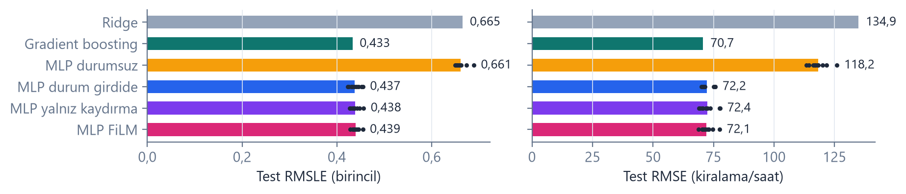

# Saatlik bisiklet kiralama tahmini: günün durumu ağa nasıl verilmeli?

[](https://colab.research.google.com/github/AxelXoket/neuromodulated-bike-demand/blob/main/bike_demand.ipynb)

Washington'daki Capital Bikeshare sisteminde saatlik kiralama sayısını tahmin eden bir makine öğrenmesi projesi. Asıl soru şu: günün durumu (haftanın günü, resmi tatil, hava durumu) bir sinir ağına sıradan bir girdi olarak mı verilmeli, yoksa ağın gizli birimlerini ölçekleyip kaydıran bir ayar sinyali (FiLM) olarak mı? Bu, Neuro_Morph araştırmamdaki sorunun küçük bir sürümü.

Makine Öğrenmesi ile Probleme Uygun Çözüm Geliştirme projesidir. Rapor: [docs/rapor.pdf](docs/rapor.pdf) (5 sayfa).



## Sonuçlar

Test dönemi Ekim-Aralık 2012. Ağlarda 10 seed ortalaması.

| Model | Durum nasıl giriyor | Test RMSLE | Test RMSE | R² |
|---|---|---|---|---|
| Ridge | girdide | 0,665 | 134,9 | 0,552 |
| Gradient boosting | girdide | 0,433 | 70,7 | 0,877 |
| MLP durumsuz | verilmiyor | 0,661 | 118,2 | 0,656 |
| MLP durum girdide | girdiye eklenir | 0,437 | 72,2 | 0,872 |
| MLP yalnız kaydırma | her katmana eklenir | 0,438 | 72,4 | 0,871 |
| MLP FiLM | her katmanı ölçekler ve kaydırır | 0,439 | 72,1 | 0,872 |

- Durum bilgisi belirleyici: durum girdide eksi durumsuz RMSLE farkı -0,223, %95 aralığı [-0,271; -0,175].
- Durumun ağa nasıl girdiği önemli çıkmadı: FiLM eksi durum girdide +0,002 [-0,009; +0,012], FiLM eksi yalnız kaydırma +0,001 [-0,007; +0,010]. İki aralık da sıfırı içeriyor; FiLM hipotezim bu veride desteklenmedi.
- En düşük test RMSLE'si Gradient boosting'in, ama durumu girdiye ekleyen ağla farkı -0,004 [-0,024; +0,016]; ikisi ayırt edilemiyor. En büyük hatalar Noel'in üç gününde (veride 24 ve 26 Aralık iş günü), başkanlık seçimi gecesinin ertesinde (7 Kasım) ve çok nemli ama kuru bir Cumartesi'de (8 Aralık). Nedenleri raporun 7. bölümünde.

Aralıklar iki seviyeli eşleştirilmiş bootstrap ile (10.000 tekrar): her turda seed'ler ve 92 test günü yeniden çekiliyor, iki model için aynı.

## Yöntem kısaca

- Veri: [UCI Bike Sharing Dataset](https://archive.ics.uci.edu/dataset/275/bike+sharing+dataset), hour.csv, 17.379 saat, CC BY 4.0. Atıf: Fanaee-T, H. ve Gama, J. (2013), Progress in Artificial Intelligence, doi:10.1007/s13748-013-0040-3. Dosya `data/hour.csv` olarak depoda.
- `casual` ve `registered` (toplamları `cnt`), `atemp` (hissedilen sıcaklık; `temp` ile korelasyonu 0,988 ve iki gün boyunca tek değerde takılı), `instant`, ayrıca `workingday` (gün ve tatilden türüyor) ve `season` (takvimi izliyor, ay zaten girdi) çıkarıldı. Nemin 0 okunduğu gün zamana göre dolduruldu, hava durumu 4 (3 satır) 3'e katıldı.
- Girdiler iki ayrı grup: x = saat (one-hot), ay (sinüs, kosinüs), yıl, sıcaklık, nem, rüzgâr; s = haftanın günü, resmi tatil, hava durumu. Hiçbir s sütunu x'ten çıkarılamıyor.
- Bölme zamana göre: eğitim Ocak 2011-Haziran 2012, doğrulama Temmuz-Eylül 2012, test Ekim-Aralık 2012. Ölçekleme yalnız eğitim aylarından.
- Ayarlar doğrulamada seçildi, son modeller eğitim ve doğrulama aylarıyla yeniden eğitildi. Dört ağın parametre sayısı %1 içinde eşit (yaklaşık 22.000), ayar bütçesi ve batch sırası aynı.
- FiLM: `h = ReLU((W·x + b) ⊙ (1 + A·s) + B·s)`; A ve B sıfırdan başlıyor. Yalnız kaydırma ağı ölçeklemeyi atıyor, böylece FiLM'in çarpımsal parçası ayrı ölçülüyor.

## Nasıl çalıştırılır

Python 3.14 ile denendi. GPU sürümü için torch'u CUDA dizininden kurun; CPU'da da çalışır, daha yavaş. Not defteri Colab'ın kendi paketleriyle çalışır; temiz bir kopyada Python 3.13, pandas 2.2.3, numpy 2.1.3, matplotlib 3.10.0, scikit-learn 1.6.1 ve CPU torch 2.15.0 ile hatasız koştu.

```bash
python -m pip install -r requirements.txt
```

```bash
python -m pip install torch==2.10.0 --index-url https://download.pytorch.org/whl/cu128
```

Deney (RTX 5080'de yaklaşık 3,5 dakika), grafikler, rapor ve not defteri tek komutla yeniden üretilir:

```bash
python tools/rebuild.py
```

Betik sırayla `python -m bike_demand.train`, `tools/figures.py`, `tools/build_report.py` ve `tools/build_notebook.py` çalıştırır; bir adım hata verirse durur. Rapor, sayfaları başsız Microsoft Edge ile PDF'e basar (Windows yolu `tools/render.py` içinde); her sayfanın taşmadığı basmadan önce ölçülür. Seed'ler sabit; aynı makinede deney aynı sonuçları verir.

## Testler

İki şerit var. `tests/` kapı testleridir: ağ yok; testlerin kendisi yaklaşık 2,7 saniye (bunun 0,75 saniyesi torch'un ilk optimizer'da yaptığı tek seferlik yükleme), Python ve torch'un açılışıyla birlikte yaklaşık 6 saniye; her commit'ten önce koşar. `slow_tests/` gerçek eğitim döngülerini, rapordaki nem karşı olgusunu ve başsız Edge'i dener, yaklaşık 6 saniye sürer.

```bash
python -B -m unittest discover -s tests -t .
```

```bash
python -B -m unittest discover -s slow_tests -t .
```

- `test_data.py`: sızıntı yapan sütunlar hiçbir girdiye ulaşmıyor, zaman bölmesi, ölçeklemenin yalnız eğitim aylarından gelmesi (sonraki aylar bozulunca değişmiyor), x ve s'nin ayrık olması, eksik saat ve aykırı değer sayımı.
- `test_models.py`: durumun nereye girdiği, FiLM ve kaydırma ağlarının durumsuz ağ olarak başlaması, ölçekleme ve kaydırmanın elle hesaplanan değeri, eşit parametre sayısı.
- `test_train.py`: metrikler, bootstrap'ın tek günden ya da tek seed'den gelen farka güvenmemesi, her ağın aynı seed'de aynı batch sırasını görmesi.
- `test_results.py`: `results/` kendi içinde tutarlı; her seed'in metrikleri kayıtlı tahminlerden yeniden hesaplanıyor; şekillerde sayılar Türkçe biçimde; Segoe UI olmayan makinede (Colab) şekiller uyarısız DejaVu Sans ile çiziliyor.
- `test_report.py`, `test_notebook.py`: raporun sayfa sayısı, bağlantıları, sayıların sonuç dosyasından gelmesi, satır sonu kuralları; not defterinin hatasız çalışmış olması; yeniden üretim betiğinin hata veren adımda durması.
- `test_text_hygiene.py`: depodaki her metin dosyasında uzun tire, yasaklı üslup kelimesi ve CRLF yok. UCI veri dosyası yayımlandığı haliyle, bayt bayt saklanıyor.
- `slow_tests/test_training.py`: erken durdurmanın en iyi epoch'u geri getirmesi, sabır sınırı, aynı seed'in aynı koşuyu vermesi, sabit epoch'lu yeniden eğitim, ayar seçimi, FiLM'in durumla tersine dönen bir kuralı öğrenmesi.
- `slow_tests/test_counterfactual.py`: nem karşı olgusu kayıtlı modelin tahmininden başlıyor ve yalnız nemle değişiyor.
- `slow_tests/test_render.py`: taşma denetimi gerçek bir başsız Edge'de.

Testlerin gerçekten bir şey yakaladığını görmek için kuralları tek tek bozan mutasyonlar projenin geçici bir kopyasında koşar:

```bash
python -B tools/mutation_check.py
```

## Klasörler

```
bike_demand/   data.py (yükleme, temizlik, bölme, girdiler), models.py (dört ağ), train.py (deney)
tools/         rebuild.py, figures.py, build_report.py, build_notebook.py, render.py (Edge), mutation_check.py
data/          hour.csv
results/       metrics.json, predictions.csv (her model ve seed için test tahminleri)
figures/       rapordaki grafikler
docs/          rapor.pdf
tests/         kapı testleri
slow_tests/    eğitim döngüsü ve Edge testleri
```

## Bilinen sınırlar

- Hava, o saatin gerçekleşen havası. Gerçek bir ileri tahminde hava tahmininin kendi hatası da eklenir.
- Tatil bilgisi yalnız resmi tatiller; Noel arifesi gibi fiilî izin günleri veride iş günü görünüyor.
- Test tek bir sonbahar; iki yıllık veride başka bir yılın aynı aylarıyla tekrar edilemiyor.
- Rüzgâr 2.180 saatte 0; sakin hava ile ölçülmemiş saat ayırt edilemiyor.
